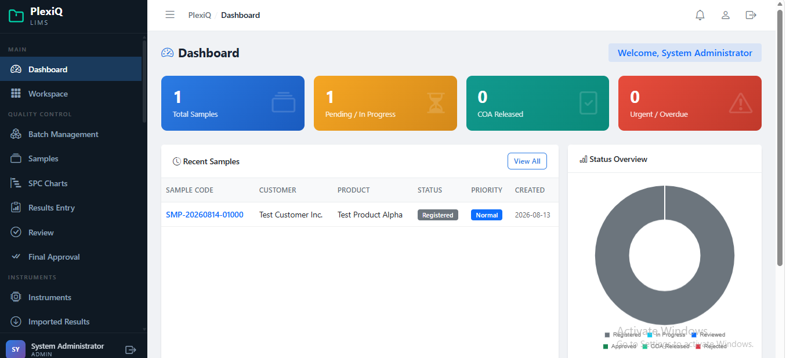
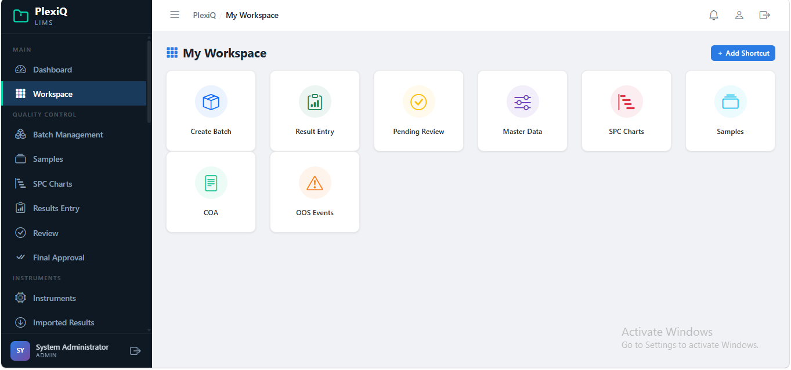
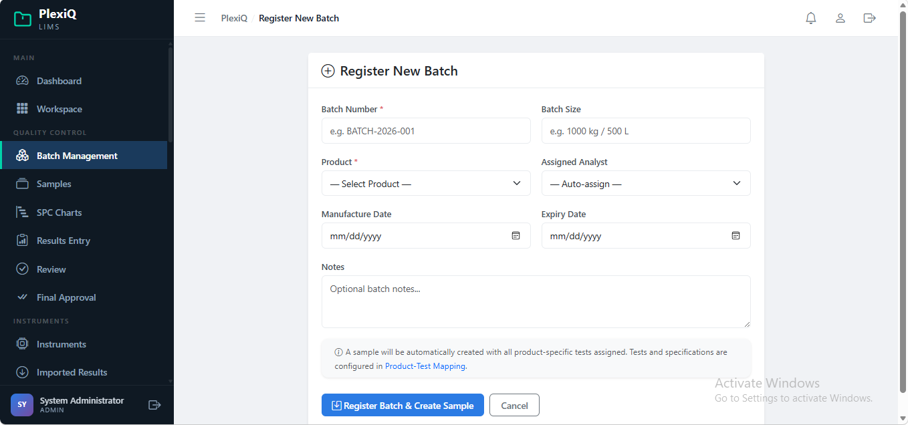
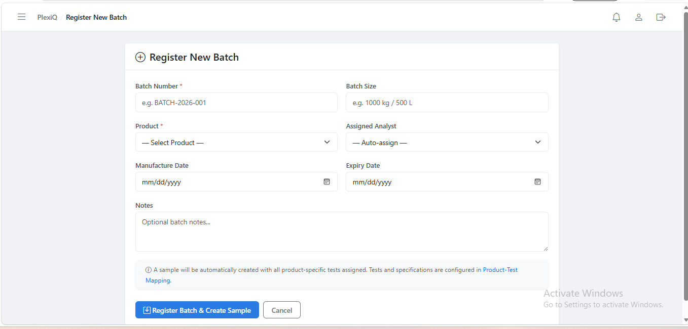
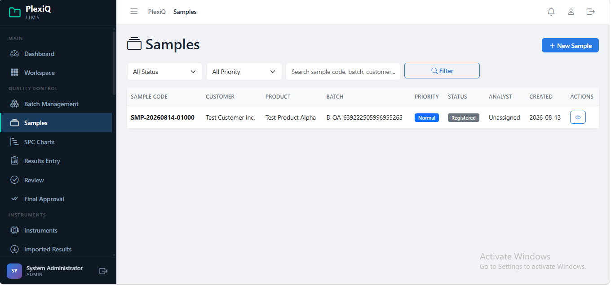
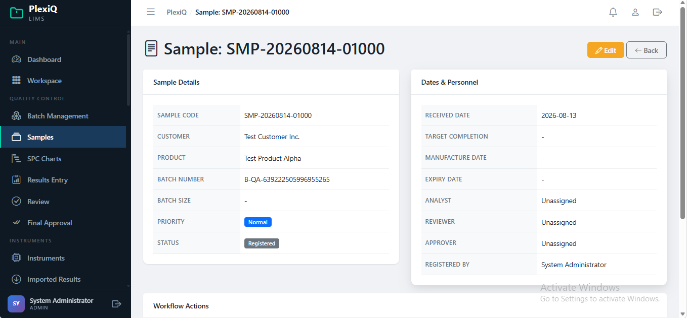

<div align="center">
  
  <h1>PlexiQ LIMS</h1>
  <p><strong>Enterprise-Grade, Regulated Laboratory Information Management System</strong></p>
  <p>PHP 8.2+ · PostgreSQL · 21 CFR Part 11 · EU Annex 11 · ISO/IEC 17025 · GAMP 5 · Docker-Ready</p>
</div>

## Overview

PlexiQ LIMS is a high-performance, enterprise-grade Laboratory Information Management System designed for QC/QA, research, and regulated life-sciences laboratories (pharmaceutical, biotech, clinical diagnostics, chemical, environmental, food & beverage).

Closing commercial, scientific, and regulatory gaps against tier-1 systems (LabWare, STARLIMS, LabVantage, Thermo SampleManager), PlexiQ delivers end-to-end sample lifecycle tracking, immutable ALCOA+ audit trails, multi-facility tenancy, instrument automation, ERP bus integration (SAP S/4HANA, Oracle Cloud, Microsoft Dynamics 365), clinical HL7/FHIR gateway, dynamic form schema engines, and AI-assisted quality diagnostics.

## Screenshots

<table>
  <tr>
    <td></td>
    <td></td>
  </tr>
  <tr>
    <td></td>
    <td></td>
  </tr>
  <tr>
    <td></td>
    <td></td>
  </tr>
</table>

## Core Capabilities & Commercial Upgrades

### 1. Regulatory Compliance & Forensic Integrity
- **21 CFR Part 11 & EU Annex 11 E-Signatures**: Dual-credential authentication (username + password + manifestation of intent + reason for signing + timestamp).
- **Cryptographic Audit Hash Chain (ALCOA+)**: Immutable SHA-256 hash chaining on all `audit_logs` records (`prev_hash` &rarr; `current_hash`). Verified via CLI console (`bin/console audit:verify`) with zero breaks or tampering.
- **Automated GAMP 5 Traceability Matrix (`/validation/matrix`)**: Live verification linking User Requirements Specifications (URS) and Functional Specifications (FS) to automated PHPUnit test methods with 100% test coverage.
- **Forensic Raw Data Vault (`/instruments/vault`)**: Tamper-proof instrument file repository computing SHA-256 checksums at ingest, retaining original files, and preventing unauthorized modification or deletion.
- **Configurable Password Policies & MFA**: Strict entropy enforcement, aging, 5-generation password history, progressive account lockout, and TOTP 2FA.

### 2. Scientific & Laboratory Operations Depth
- **Sample Genealogy & Lineage (`/samples/{id}/genealogy`)**: Hierarchical aliquot derivation, composite pooling, split sample trees, and visual parent-child genealogy tracking.
- **2D/3D Storage Grid & Cold-Chain Management (`/storage`)**: Interactive visual box matrices (8x8, 9x9, 10x10), coordinate-level check-in/out (`A1`, `H8`), storage capacity heatmaps, freeze-thaw cycle counters, and temperature history.
- **Dynamic Formula & Calculation Engine (`/formulas`)**: Sandboxed formula parser and Abstract Syntax Tree (AST) evaluator with variable dependency graphs, multi-parameter limits, rounding rules, and auto-OOS/OOT triggers.
- **High-Speed Bench Data Entry (`/bench`)**: Barcode-driven, keyboard-first grid interface with real-time autosave, status indicators, and batch result approval workflows.
- **Direct Thermal Label Printing (`/labels/templates`, `/labels/preview`)**: ZPL II (Zebra), ESC/POS, and Brother direct thermal code generation with 2D DataMatrix, QR, and Code 128 barcodes.

### 3. Regulated Quality Lifecycle & Statistics
- **GAMP Competency & Training Gating (`/training/assignments`)**: Method and instrument qualification matrix that programmatically blocks unqualified analysts from recording or approving test results.
- **Change Control Governance (`/change-controls`)**: 21 CFR Part 211 / EU Annex 11 change management workflows covering methods, specifications, instruments, and facilities with regulatory impact assessments and pre-approvals.
- **Out-of-Trend (OOT) Detection Engine (`/oot`)**: Historical rolling mean shifts, standard deviation threshold analysis, and proactive alert generation before formal OOS failure occurs.
- **Method Validation & Uncertainty Budgets (`/quality/uncertainty`)**: ISO/IEC 17025 and GUM-compliant expanded measurement uncertainty ($k=2, 95\%$ confidence level), Type A/B error budgeting, and Monte Carlo confidence intervals.
- **Accelerated & Long-Term Stability (`/quality/stability/regression`)**: Arrhenius reaction kinetics, Arrhenius activation energy ($E_a$), shelf-life poolability ANCOVA, and $T_{90}$ shelf-life regression extrapolation.
- **AI-Assisted Quality Diagnostics (`/quality/ai-advisor`)**: Ishikawa 6M classification (Man, Machine, Material, Method, Measurement, Milieu), 5-Whys diagnostic chains, automated CAPA drafting, and Part 11 human electronic sign-off.

### 4. Instrument Automation & Edge IoT
- **Autosampler Sequence & Worklist Builder (`/instruments/worklists`)**: Export drivers for Waters Empower, Agilent ChemStation / OpenLab CDS, Thermo Fisher Chromeleon, and Shimadzu LabSolutions.
- **Edge IoT Instrument Collector (`bin/edge-agent.php`)**: Background collector service monitoring instrument drop directories and RS-232/TCP socket outputs, calculating checksums, and pushing raw files into the vault.
- **Modular Parser Registry**: Extensible drivers parsing chromatograms, mass spectrometers, balances, spectrometers, and generic CSV/XML files.

### 5. Enterprise Integration & Clinical Gateway
- **Enterprise ERP Quality Bus (`/erp`)**: Out-of-the-box bidirectional connector interface supporting SAP S/4HANA (OData/RFC), Oracle Cloud ERP (REST/SOAP), and Microsoft Dynamics 365 Supply Chain Management.
- **Enterprise Identity & SSO**: Native Active Directory / OpenLDAP user synchronization with role-mapping, SAML 2.0 Identity Provider assertions, and OAuth2/OIDC.
- **Clinical & Diagnostic Gateway (`/clinical`)**: HL7 v2.5.1 ORU^R01 message generator/parser and HL7 FHIR R4 Bundle Observation and DiagnosticReport resource exports.
- **BI & Streaming Analytics Feed (`/api/analytics/stream`, `/api/analytics/bi-feed`)**: High-throughput NDJSON streaming endpoint and live feed for PowerBI, Tableau, and Snowflake data ingestion.

### 6. Zero-Code Flexibility & Multi-Site Scale
- **Dynamic Form Schema Builder (`/forms/schemas`)**: Drag-and-drop zero-code schema designer with field validations, conditional visibility, and custom inspection types.
- **Cryptographic Environment Promotions (`/forms/schemas`)**: HMAC-SHA256 signed configuration packages enabling safe, auditable promotion of schemas and workflows from DEV to UAT to PROD.
- **Multi-Facility & Multi-Site Tenancy (`/sites`)**: Enterprise site scoping (`SITE-BOS-01`, `SITE-DUB-02`, etc.) with user facility switching and strict cross-site data isolation.
- **Asynchronous Dead-Letter Job Queues (`/ops/queue`)**: High-capacity queue engine with exponential backoff retries, dead-letter queue (DLQ) inspection, and job replay.
- **CycloneDX 1.5 SBOM & Vulnerability Scanner (`/ops/sbom`)**: Built-in Software Bill of Materials (SBOM) generator in CycloneDX 1.5 JSON standard with automated open-source license scanning.
- **PostgreSQL Table Partitioning Strategy (`/ops/partitioning`)**: Partitioning monitor for Hot, Warm, and Cold tiering of high-volume `audit_logs` and `results` tables.

---

## Technical Specifications

| Component | Specification |
|-----------|---------------|
| **Runtime** | PHP 8.2 – 8.3 |
| **Database** | PostgreSQL 12+ (Recommended: PostgreSQL 16) |
| **Web Server** | Apache (with `mod_rewrite`), Nginx, or PHP CLI built-in server |
| **Required Extensions** | `pdo_pgsql`, `pgsql`, `json`, `curl`, `session`, `mbstring` |
| **Optional Extensions** | `ldap` (Active Directory), `odbc` (SAP HANA direct), `dom` (PDF COA generation) |
| **Standards Compliance** | 21 CFR Part 11, EU Annex 11, ISO/IEC 17025, GAMP 5, ALCOA+, HL7 FHIR R4, CycloneDX 1.5 |

> **XAMPP Windows Users:** Enable the PostgreSQL extensions in `C:\xampp\php\php.ini`:
> ```ini
> extension=pdo_pgsql
> extension=pgsql
> ```

---

## Quick Start

### 1. Clone & Environment Configuration

```bash
git clone https://github.com/bhnvboy-cell/plexiq-lims.git
cd plexiq-lims
copy .env.example .env
```

Edit `.env` to configure your PostgreSQL credentials:
```ini
DB_HOST=127.0.0.1
DB_PORT=5432
DB_DATABASE=limsdb
DB_USERNAME=postgres
DB_PASSWORD=your_password
```

### 2. Database Setup & Migrations

```bash
# Create database and seed base tables
psql -U postgres -d limsdb -f database/schema.sql
psql -U postgres -d limsdb -f database/seed_data.sql

# Apply all migrations (001 through 024)
for %f in (database\migrations\*.sql) do psql -U postgres -d limsdb -f "%f"
```

### 3. Start Development Server

```bash
php -d extension=pdo_pgsql -d extension=pgsql -S 127.0.0.1:8080 -t public public/router.php
```

> **Note:** The `public/router.php` front router is required so static assets and API/download endpoints route correctly through `public/index.php`.

### 4. Default Credentials

| Role | Username | Password |
|------|----------|----------|
| **System Administrator** | `admin` | `Admin123!` |
| **Analyst** | `analyst` | `Admin123!` |
| **Quality Reviewer** | `reviewer` | `Admin123!` |
| **Approver** | `approver` | `Admin123!` |
| **Client Portal** | `customer` | `Admin123!` |

---

## CLI Console & Background Services

PlexiQ provides a unified CLI console (`bin/console`) for regulatory audits, background queues, and operations:

```bash
# 1. Verify ALCOA+ Audit Trail Hash Chain Integrity (21 CFR Part 11 check)
php bin/console audit:verify

# 2. Monitor & Run Background Job Queue
php bin/console queue:monitor
php bin/console queue:work --queue=default --once

# 3. Export CycloneDX 1.5 SBOM
php bin/console sbom:generate

# 4. Scan Instrument Drop Folders (Edge Collector)
php bin/console instrument:scan

# 5. Database Backup & Restore Operations
php bin/console backup:run --type=manual
php bin/console backup:list
php bin/console backup:prune

# 6. Cache Management
php bin/console cache:clear
```

---

## Automated Verification & Test Suite

The test suite validates compliance, scientific calculations, integrations, and security boundaries across all modules:

```bash
# Run complete test suite (138 tests, 2,840 assertions)
php -d extension=pdo_pgsql -d extension=pgsql phpunit.phar

# Run Unit tests only
php -d extension=pdo_pgsql -d extension=pgsql phpunit.phar --testsuite Unit

# Run Feature tests only
php -d extension=pdo_pgsql -d extension=pgsql phpunit.phar --testsuite Feature

# Run k6 high-concurrency load benchmark (200 concurrent analysts)
k6 run tests/k6/lims_load_benchmark.js
```

---

## Directory Architecture

```
plexiq-lims/
├── app/
│   ├── Controllers/        # MVC Controllers (ChangeControl, ERP, Clinical, Forms, AI, Bench)
│   ├── Helpers/            # Database, Auth, Audit, TenantContext (Multi-Site), Session
│   ├── Middleware/         # Auth, CSRF, SecurityHeaders (CSP, HSTS)
│   ├── Models/             # Active Record models with scopes and audit trails
│   └── Services/           # Domain business logic:
│       ├── Ai/             # QualityAiAdvisorService (Ishikawa 6M, 5-Whys, CAPA)
│       ├── Auth/           # LdapService, SamlService
│       ├── Calculations/   # Dynamic Formula AST calculation engine
│       ├── Clinical/       # FhirService (R4 bundles), Hl7MessageService (ORU^R01)
│       ├── DynamicForms/   # FormSchemaService, PromotionPackageService (HMAC signing)
│       ├── Erp/            # SapHana, OracleCloud, Dynamics ERP connectors
│       ├── Instruments/    # WorklistBuilder, EdgeAgent, ParserRegistry
│       ├── Ops/            # QueueService, SbomService, PartitioningService
│       ├── Quality/        # OotDetectionService, UncertaintyBudgetService, StabilityService
│       └── Validation/     # TraceabilityService (GAMP 5 RTM engine)
├── bin/
│   ├── console             # CLI management console
│   ├── edge-agent.php      # Edge IoT collector service
│   └── worker.php          # Background job queue worker
├── database/
│   ├── migrations/         # Schema migrations (001_initial.sql through 024_scale_multisite.sql)
│   ├── migrations/rollbacks/ # Rollback SQL scripts for every migration
│   ├── schema.sql          # Baseline PostgreSQL schema
│   └── seed_data.sql       # Initial master tables and roles
├── public/                 # Web server document root
│   ├── assets/             # Bootstrap 5, Bootstrap Icons, Chart.js, styles
│   ├── index.php           # Front controller
│   └── router.php          # Built-in PHP development router
├── resources/views/        # View templates (rendered via layout('app'))
├── routes/                 # Route declarations (web.php, api.php)
├── storage/                # Vault files, logs, sessions, backups, keys
└── tests/                  # PHPUnit test suites & k6 load benchmarks
```

---

## License

PlexiQ LIMS is open-source software licensed under the [MIT License](LICENSE).
